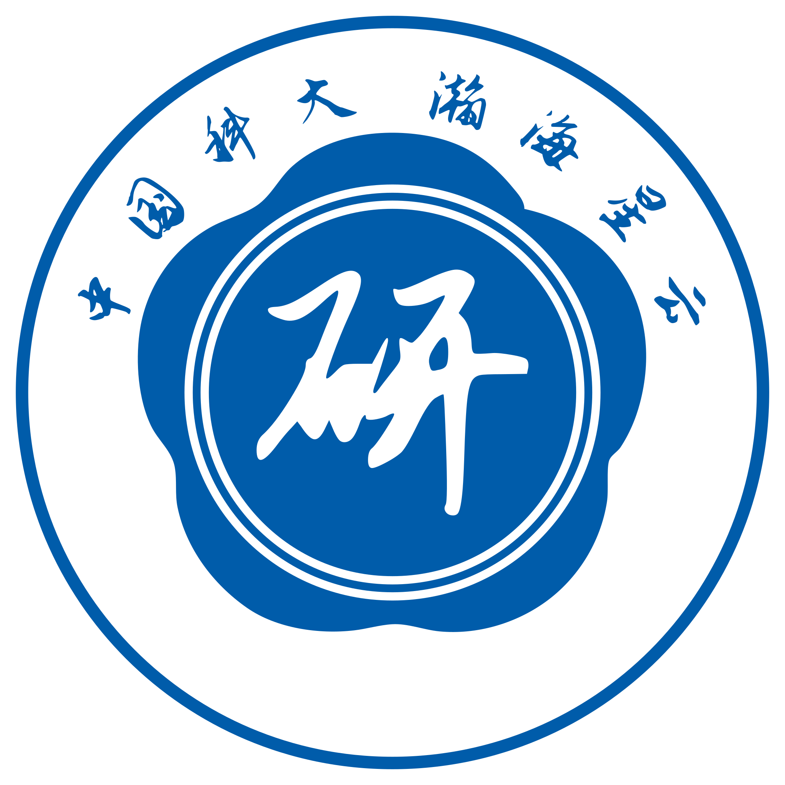
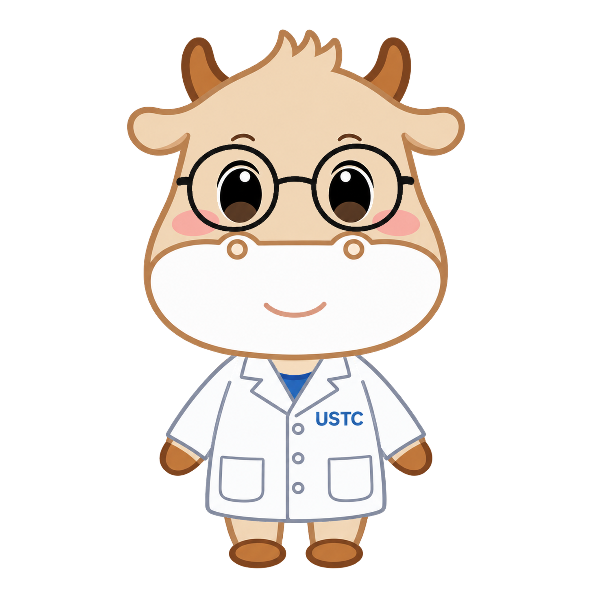

# 中国科大本科科研实践平台征集投稿

参加中国科学技术大学“本科科研实践平台”名称、图标与互动形象征集活动的个人设计作品，包含“瀚海星云”名称与徽标方案，以及基于科小牛形象设计的科研 AI 助手。

这是个人投稿归档，不是平台源代码或学校官方发布。平台入口：[rstar.ustc.edu.cn](https://rstar.ustc.edu.cn/)（官方通知说明仅限校内访问）。

## 作品预览

### 瀚海星云：名称与徽标方案

以蓝白配色、梅花形结构和行书“研”字表达科研探索主题。“瀚海星云”是本次投稿提出的名称，不代表平台已采用该名称。

- [作品说明](瀚海星云徽标/README.md)
- [PNG 预览](瀚海星云徽标/output/瀚海星云_预览.png) · [分层 PSD](瀚海星云徽标/output/瀚海星云_源文件.psd)
- [创意与背景](瀚海星云徽标/创意说明&背景描述.txt) · [制作与检查](瀚海星云徽标/制作说明.md)

### 科小牛科研助手：互动形象方案

在科小牛既有形象基础上加入圆框眼镜、白大褂和科研助手设定，保存独立部件及可编辑图层。

- [作品说明](科小牛科研助手/README.md)
- [白色背景 PNG](科小牛科研助手/科小牛科研助手_白色背景.png) · [透明背景 PNG](科小牛科研助手/科小牛科研助手_透明背景.png) · [分层 PSD](科小牛科研助手/科小牛科研助手.psd)
- [设计说明](科小牛科研助手/设计说明.md) · [AI 辅助创作说明](科小牛科研助手/AI辅助创作说明.md)
- [制作素材与提示词](科小牛科研助手/制作素材/) · [制作代码](科小牛科研助手/制作工具/)

## 文件与制作

两组作品均提供 2048×2048 PNG 和分层 PSD。直接查看或下载成品无需安装代码依赖。制作环境与复现步骤见 [制作指南](DEVELOPMENT.md)。依赖、安装缓存、临时检查文件和旧版本不纳入仓库。

## 投稿状态与权利说明

截至 2026 年 11 月 6 日，两件作品已投稿，作者尚未确认评选结果。本仓库用于个人投稿记录与展示，不表示入围、获奖或被学校采用。

本仓库不提供 MIT、Creative Commons 等整体使用许可，公开可见不等于授予任意复制、修改、再分发或商业使用的许可。科小牛既有形象、学校名称、USTC 字样、校徽及参考图片所涉及的权利不由本仓库授予；作者新增设计也不消除基础素材的权利。

官方征集方案规定：**获奖作品著作权归中国科学技术大学所有，设计者永久保留作品署名权**，学校拥有获奖作品的独家使用权、修改权、二次创作权等相关衍生权利。实际获奖后的权属与使用范围以活动约定及相关许可为准。本说明本身不是学校或基础素材权利人的授权。

随附“志莽行书”字体按原 [SIL Open Font License](瀚海星云徽标/assets/fonts/OFL-ZhiMangXing.txt) 提供，不适用上述未授予额外许可的表述。第三方依赖遵循各自许可证。

活动依据：[教务处征集通知](https://www.teach.ustc.edu.cn/notice/notice-info/20596.html) · [征集方案附件](https://www.teach.ustc.edu.cn/?attachment_id=20598)。
